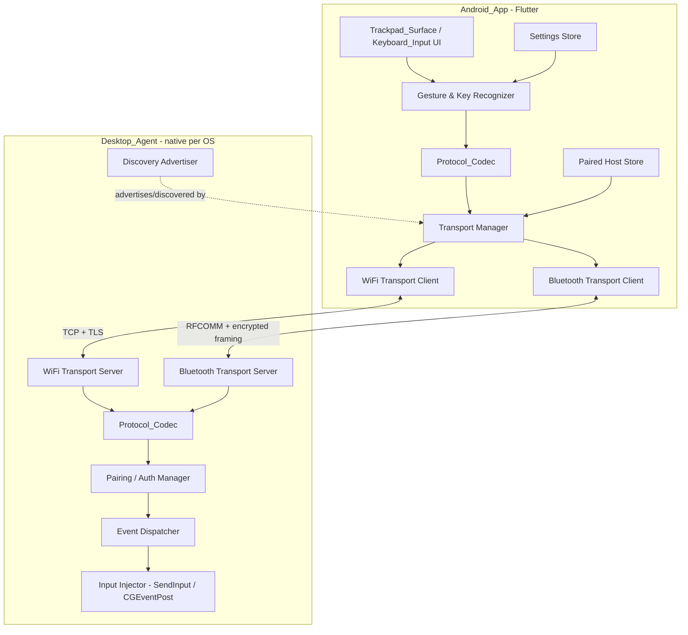
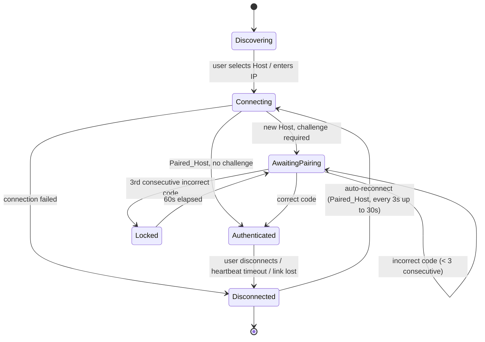
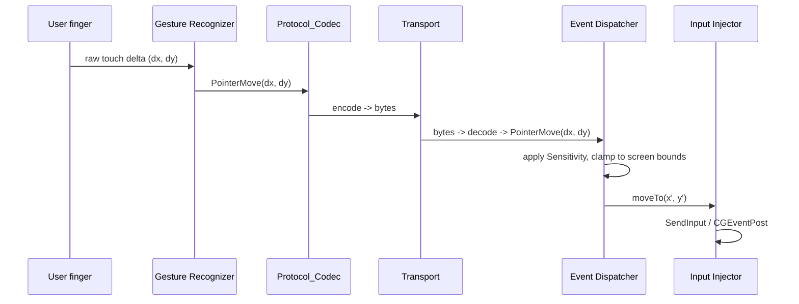

# Design Document

## Overview

Android Remote Input consists of two independently deployable programs that communicate over a custom binary protocol:

- **Android_App**: A Flutter application (Android target) that renders the Trackpad_Surface and Keyboard_Input, captures gestures/keystrokes, and sends them as Input_Events over a Connection.
- **Desktop_Agent**: A native background application for macOS and Windows that discovers itself to the Android_App, authenticates Connections, receives Input_Events, and injects them into the OS using platform input-injection APIs.

The two sides share a single wire protocol (the Protocol_Codec) so that the Wi-Fi Transport and Bluetooth Transport carry identical message framing, differing only in the byte-stream carrier underneath.

**Key technology decisions:**

- The Android_App is built with Flutter/Dart, matching the existing project.
- The Desktop_Agent is **not** built with Flutter desktop. It is a small native/host-language program per platform (Swift on macOS, C#/.NET or C++ on Windows), because:
  - Input injection requires OS-specific APIs that need direct platform access and specific OS permissions: macOS `CGEventPost` via Quartz Event Services (requires Accessibility permission), Windows `SendInput` via the Win32 API (user32.dll) ([win32 Dart FFI SendInput example](https://github.com/halildurmus/win32/blob/main/examples/sendinput.dart)).
  - The agent has no complex UI beyond a pairing-code display and a system-tray/menu-bar presence, so a full Flutter engine is unnecessary overhead for a background service.
  - This matches how comparable remote-input tools are built: a thin native shim for injection, independent of the mobile client's framework.
- Bluetooth Transport on Android uses Bluetooth Classic (RFCOMM/SPP), not BLE, because the data channel needs a continuous, low-overhead, bidirectional byte stream similar to a socket, which SPP provides directly; BLE's GATT characteristic model is built for small, infrequent reads/writes and adds overhead unsuited to a 60+ events/sec pointer stream. Packages such as `flutter_blue_classic` or `flutter_bluetooth_serial_ble` expose RFCOMM client connections from Flutter ([flutter_blue_classic](https://github.com/LenhartStephan/flutter_blue_classic/blob/main/README.md)).
- Wi-Fi Transport uses a TCP socket, with mDNS/Bonjour-style advertisement for discovery (the Desktop_Agent advertises a service; the Android_App browses for it) and TLS (or an equivalent authenticated-encryption handshake) layered on top for the encryption required by Requirement 4.7.

## Architecture

### High-level component diagram



### Connection lifecycle (state machine)



### Process flow: pointer movement



## Components and Interfaces

### Android_App components

- **Gesture Recognizer**: A pure function layer (`GestureClassifier`) that consumes a stream of raw touch samples (finger count, position, timestamp) and emits a sealed set of `GestureEvent`s: `PointerMove`, `LeftClick`, `RightClick`, `DoubleClick`, `DragStart/DragMove/DragEnd`, `ScrollEvent`, `AppSwitchEvent`. Being a pure function of touch input (plus settings like tap-to-click and natural-scrolling), it is the primary target for property-based testing.
- **Keyboard Recognizer**: Maps Flutter `KeyEvent`s (including modifier toggle state held in app state) to `KeyInputEvent`s with a Unicode codepoint or a `SpecialKey` enum value (Backspace, Enter, Tab, Escape, Delete, arrows, F1–F12) plus an active-modifier set.
- **Protocol_Codec** (`shared` package, see below): Encodes/decodes `InputEvent` to/from bytes.
- **Transport Manager**: Chooses between `WifiTransportClient` and `BluetoothTransportClient` based on the selected Host, owns the Connection state machine, and runs the heartbeat/reconnect timers.
- **Paired Host Store**: Persists `{hostId, hostName, lastTransport, sharedSecret}` using secure on-device storage (e.g., `flutter_secure_storage`), keyed by a stable Host identifier.
- **Settings Store**: Persists Sensitivity, natural-scrolling flag, tap-to-click flag using a key-value store (e.g., `shared_preferences`), validating Sensitivity against [0.5, 5.0] on write.

### Desktop_Agent components

- **Discovery Advertiser**: Publishes an mDNS/Bonjour service (Wi-Fi) and makes the device discoverable/advertises an SPP service record (Bluetooth), including Host name and OS in the advertised metadata.
- **Pairing / Auth Manager**: Generates a 6-digit Pairing_Code, tracks consecutive-failure counts per pending Connection, enforces the 60-second lockout, and maintains the authenticated/unauthenticated state per Connection.
- **Protocol_Codec**: Same wire format as the Android_App's codec (ideally generated from one shared schema or ported line-for-line, since Requirement 10.7 mandates format parity across transports and implicitly across implementations).
- **Event Dispatcher**: Receives decoded `InputEvent`s for authenticated Connections only (Requirement 4.6), applies Sensitivity scaling and screen-bounds clamping for pointer events, tracks currently-held buttons/modifiers (for release-on-disconnect, Requirement 11.5), and forwards resolved native actions to the Input Injector.
- **Input Injector**: Platform-specific adapter — Windows: `SendInput` via `user32.dll` FFI; macOS: `CGEventPost`/`CGEventCreateMouseEvent`/`CGEventCreateKeyboardEvent` via Quartz Event Services. Exposes a single internal interface (`moveTo`, `click`, `keyDown`, `keyUp`, `scroll`) so the Dispatcher is platform-agnostic.

### Shared Protocol_Codec interface

```
sealed class InputEvent
  PointerMove(dx: f32, dy: f32)
  ButtonAction(button: Left|Right, action: Down|Up)
  ClickAction(button: Left|Right, clickCount: 1|2)
  ScrollEvent(dx: f32, dy: f32)
  ZoomEvent(magnitude: f32)   // reserved wire type (0x05); no longer produced by the app, ignored by the agent
  AppSwitchEvent()
  KeyAction(key: Char(codepoint) | Special(enum), modifiers: Set<Modifier>, action: Down|Up)
  Heartbeat()

ProtocolCodec:
  encode(event: InputEvent) -> Bytes      // [version: u8][type: u8][payload...]
  decode(bytes: Bytes) -> Result<InputEvent, CodecError>
  prettyPrint(event: InputEvent) -> String

CodecError = Malformed(reason: String) | VersionMismatch(found: u8, supported: u8)
```

Message framing: 1-byte protocol version, 1-byte event-type tag, followed by a fixed or length-prefixed payload per type. Both transports deliver this same byte framing; Wi-Fi adds a length-prefix framing layer on top of the TCP stream (since TCP has no inherent message boundaries), and Bluetooth RFCOMM is naturally packet-oriented but uses the same length-prefix for consistency.

## Data Models

```
HostInfo {
  id: String                 // stable identifier (MAC / service UUID)
  name: String
  os: HostOS                 // macOS | Windows
  transport: TransportKind   // WiFi | Bluetooth
  address: String            // IP:port or Bluetooth MAC
}

PairedHost {
  hostInfo: HostInfo
  sharedSecret: Bytes        // established during pairing, used to key encryption
  pairedAt: DateTime
}

ConnectionState = Discovering | Connecting | AwaitingPairing(code, failedAttempts, lockedUntil?) 
                | Authenticated(host: HostInfo, since: DateTime) | Disconnected(reason)

AppSettings {
  sensitivity: f32            // clamped to [0.5, 5.0]
  naturalScrolling: bool
  tapToClick: bool
}

GestureSample {
  fingers: List<{id: int, x: f32, y: f32}>
  timestamp: DateTime
}
```

## Correctness Properties

*A property is a characteristic or behavior that should hold true across all valid executions of a system—essentially, a formal statement about what the system should do. Properties serve as the bridge between human-readable specifications and machine-verifiable correctness guarantees.*

### Property 1: Discovered host info renders all required fields

*For any* `HostInfo`, the host-list display mapping function SHALL produce a display record containing that host's name, operating system, and Transport.

**Validates: Requirements 1.2**

### Property 2: Manual IP validation accepts only syntactically valid addresses

*For any* string, the manual-IP validator SHALL accept it if and only if it is a syntactically valid IPv4 or IPv6 address.

**Validates: Requirements 2.2**

### Property 3: Pairing code is always a 6-digit code

*For any* pairing-code generation call, the Pairing/Auth Manager SHALL produce a code consisting of exactly 6 decimal digits.

**Validates: Requirements 4.1**

### Property 4: Matching pairing code authenticates the Connection

*For any* displayed Pairing_Code and any entered code equal to it, the Pairing/Auth Manager SHALL transition the Connection to Authenticated and the Android_App SHALL record the Host as a Paired_Host.

**Validates: Requirements 4.2**

### Property 5: Non-matching pairing code rejects the Connection

*For any* displayed Pairing_Code and any entered code that differs from it, the Pairing/Auth Manager SHALL reject the Connection and leave it unauthenticated.

**Validates: Requirements 4.3**

### Property 6: Three consecutive incorrect codes trigger a lockout

*For any* sequence of pairing attempts against a single displayed code, if the three most recent consecutive attempts are all incorrect, the Pairing/Auth Manager SHALL invalidate the code and refuse new pairing attempts until 60 seconds have elapsed.

**Validates: Requirements 4.4**

### Property 7: Known paired hosts skip the pairing challenge

*For any* Host present in the Paired Host Store, connecting to it SHALL transition directly to Authenticated without issuing a Pairing_Code.

**Validates: Requirements 4.5**

### Property 8: Unauthenticated connections never affect injected state

*For any* `InputEvent` and any Connection not in the Authenticated state, dispatching that event through the Event Dispatcher SHALL leave all injector-visible state (pointer position, held buttons, held modifiers) unchanged.

**Validates: Requirements 4.6**

### Property 9: Input event encryption round-trips and conceals plaintext

*For any* `InputEvent` and any established Connection key, encrypting then decrypting the event SHALL reproduce the original event, and the produced ciphertext bytes SHALL differ from the plaintext-encoded bytes.

**Validates: Requirements 4.7**

### Property 10: Removing a paired host deletes only that host's data

*For any* non-empty set of `PairedHost`s and any host within that set, removing it from the Paired Host Store SHALL cause subsequent lookups for that host to return not-found, while lookups for every other host in the original set are unaffected.

**Validates: Requirements 4.8**

### Property 11: Pointer movement preserves relative displacement

*For any* sequence of single-finger touch deltas, the Gesture Recognizer SHALL emit `PointerMove` events whose (dx, dy) values equal the corresponding raw touch deltas (within floating-point rounding tolerance).

**Validates: Requirements 5.1**

### Property 12: Pointer movement is scaled by sensitivity and clamped to the display

*For any* current pointer position, displacement (dx, dy), Sensitivity in [0.5, 5.0], and display bounds, the Event Dispatcher SHALL compute the new position as `clamp(position + displacement * sensitivity, bounds)`.

**Validates: Requirements 5.2, 5.6**

### Property 13: The most recently set sensitivity is always used

*For any* sequence of Sensitivity changes followed by a pointer movement, the movement calculation SHALL use the value from the most recent change in the sequence.

**Validates: Requirements 5.5**

### Property 14: Single-finger tap classifies as a left click

*For any* single-finger touch sequence whose duration and travel distance are within the tap thresholds, the Gesture Recognizer SHALL classify it as a `ClickAction(Left, 1)`.

**Validates: Requirements 6.1**

### Property 15: Two-finger tap classifies as a right click

*For any* two-finger touch sequence whose duration and travel distance are within the tap thresholds, the Gesture Recognizer SHALL classify it as a `ClickAction(Right, 1)`.

**Validates: Requirements 6.2**

### Property 16: Double-tap classifies as a double left click

*For any* two single-finger tap sequences occurring within the double-tap time and distance thresholds of each other, the Gesture Recognizer SHALL classify the pair as a `ClickAction(Left, 2)`.

**Validates: Requirements 6.3**

### Property 17: Tap-hold-slide classifies as a drag for the full hold duration

*For any* single-finger touch sequence consisting of a tap followed immediately by a hold-and-slide, the Gesture Recognizer SHALL emit `DragStart`, then `DragMove` events tracking the finger until it is lifted, then `DragEnd`.

**Validates: Requirements 6.4**

### Property 18: Dedicated button controls map press/release to button down/up

*For any* dedicated button control and any press-then-release interaction with it, the Gesture Recognizer SHALL emit exactly `ButtonAction(button, Down)` followed by `ButtonAction(button, Up)`.

**Validates: Requirements 6.6**

### Property 19: Two-finger slide maps to a scroll event honoring natural scrolling

*For any* two-finger slide delta (dx, dy) and any natural-scrolling flag value, the Gesture Recognizer SHALL emit a `ScrollEvent` whose magnitude equals (dx, dy) and whose sign is inverted relative to (dx, dy) if and only if the natural-scrolling flag is enabled.

**Validates: Requirements 7.1, 7.2, 7.3**

### Property 20: (Removed)

Pinch-to-zoom was removed. The Gesture Recognizer never emits a `ZoomEvent`, and the Desktop_Agent ignores a received one. The number is kept so later property numbers stay stable.

### Property 21: Three-finger horizontal slide maps to the OS-correct app-switch shortcut

*For any* three-finger horizontal slide exceeding the gesture threshold and any Host operating system, the Event Dispatcher SHALL trigger Command+Tab if the Host OS is macOS and Alt+Tab if the Host OS is Windows.

**Validates: Requirements 7.5**

### Property 22: Key event round-trips for any Unicode character

*For any* Unicode character typed by the user, encoding it into a `KeyAction` and decoding it on the Desktop_Agent side SHALL reproduce the same character, and the Input Injector SHALL be invoked to type exactly that character.

**Validates: Requirements 8.2, 8.7**

### Property 23: Active modifiers are always attached to the next key action

*For any* set of currently-toggled modifiers and any typed character or special key, the resulting `KeyAction` SHALL carry exactly that modifier set.

**Validates: Requirements 8.5**

### Property 24: Protocol encode/decode round-trips for all event types

*For any* valid `InputEvent`, decoding the bytes produced by encoding it SHALL yield an event equal to the original, and the encoded bytes SHALL contain the current protocol version and a type tag matching the event's type.

**Validates: Requirements 10.1, 10.2, 10.6**

### Property 25: Malformed messages always decode to an error, never a crash or bogus event

*For any* arbitrary byte sequence that does not conform to a valid encoded message, decoding it SHALL return a `Malformed` error rather than throwing or returning an `InputEvent`.

**Validates: Requirements 10.3**

### Property 26: Unsupported protocol versions are reported distinctly

*For any* otherwise well-formed message whose version byte is outside the set of versions the decoder supports, decoding it SHALL return a `VersionMismatch` error specifically.

**Validates: Requirements 10.4**

### Property 27: Pretty-printed output names the event type

*For any* `InputEvent`, the pretty printer SHALL produce a non-empty string containing the event's type name.

**Validates: Requirements 10.5**

### Property 28: Connection status display always reflects the active host and transport

*For any* Authenticated connection state, the connection-status display mapping SHALL include that state's Host name and Transport.

**Validates: Requirements 11.1**

### Property 29: Reconnection is attempted every 3 seconds and stops after 30 seconds

*For any* sequence of connection-loss and retry-failure events against a Paired_Host, the Transport Manager SHALL schedule the next retry 3 seconds after each failure and SHALL stop retrying once 30 seconds have elapsed since the initial loss.

**Validates: Requirements 11.3**

### Property 30: Heartbeat silence beyond 10 seconds is always treated as a dead connection

*For any* last-seen timestamp and current time where the difference exceeds 10 seconds, the Desktop_Agent SHALL consider the Connection closed.

**Validates: Requirements 11.4**

### Property 31: Closing a connection always releases all held buttons and modifiers

*For any* set of currently-held mouse buttons and modifier keys on a Connection, closing that Connection SHALL result in release events for every held button and modifier and an empty held-state set afterward.

**Validates: Requirements 11.5**

### Property 32: Background duration determines whether the connection stays open

*For any* duration the Android_App spends in the background while connected, the Connection SHALL remain open if the duration is less than 60 seconds and SHALL be closed once the duration reaches 60 seconds.

**Validates: Requirements 11.6**

### Property 33: Settings persist across restarts

*For any* valid `AppSettings` value, writing it to the Settings Store and then reading it back (simulating an application restart) SHALL return an equal value.

**Validates: Requirements 12.2**

### Property 34: Disabling tap-to-click suppresses click events from taps

*For any* tap gesture that would otherwise classify as a click, if tap-to-click is disabled, the Gesture Recognizer SHALL NOT emit a `ClickAction`; only explicit dedicated-button-control presses SHALL produce one.

**Validates: Requirements 12.3**

### Property 35: Sensitivity updates only apply within the valid range

*For any* current valid Sensitivity and any candidate value, the Settings Store SHALL update to the candidate if it lies within [0.5, 5.0], and SHALL otherwise retain the current value unchanged.

**Validates: Requirements 12.4**

## Error Handling

- **Discovery failures / no hosts found**: The Android_App shows a manual-entry affordance after a 10-second timeout with no results (Requirement 1.4); this does not throw, it is a normal empty-result UI state.
- **Permission denials**: Missing Wi-Fi/Bluetooth/Accessibility/input-injection permissions surface as explicit, actionable UI messages rather than silent failures (Requirements 1.5, 9.5). The Android_App wraps platform permission plugins and maps each denial to a specific explanatory string.
- **Connection failures**: Both Wi-Fi and Bluetooth connect paths catch transport-level exceptions (socket refused, timeout, adapter off, device unreachable) and map them to a small closed set of user-facing failure reasons (Requirements 2.4, 3.4). Bluetooth-off is special-cased into a prompt to enable Bluetooth (Requirement 3.3).
- **Pairing failures**: Incorrect codes return a typed rejection (not a thrown exception) so the UI can show "incorrect code" without tearing down the socket; the lockout state is tracked explicitly and surfaced as a disabled pairing UI with a countdown (Requirements 4.3, 4.4).
- **Malformed / version-mismatched protocol messages**: The codec never throws on bad input; `decode` returns a typed `Result`/`Either` (`Malformed` or `VersionMismatch`). The Desktop_Agent logs the pretty-printed error and discards the message, keeping the Connection alive (Requirements 10.3, 10.4).
- **Unauthenticated event injection attempts**: Defensively discarded at the Event Dispatcher boundary regardless of how they arrive (replay, race during handshake), per Property 8.
- **Unexpected disconnect / heartbeat timeout**: Triggers the release-all-held-state path (Property 31) before any reconnect attempt, so a stuck modifier or mouse button can never persist past a dropped Connection.
- **Settings validation errors**: Out-of-range Sensitivity input is rejected at the store boundary and the previous value is retained; no exception propagates to the UI, which simply shows the value unchanged (Requirement 12.4).

## Testing Strategy

**Dual testing approach.** Unit/example tests cover specific scenarios, fixed discrete mappings, and UI presence/wiring that doesn't vary meaningfully with input. Property-based tests cover the pure logic layers identified above — gesture classification, the protocol codec, the pairing state machine, the event dispatcher's arithmetic, and the settings/paired-host stores — where input variation is exactly where bugs hide.

**Property-based testing library.** The Android_App and any shared Dart logic use the `glados` or `dart_check` package for property-based testing in Dart (or an equivalent mature PBT library available for the chosen Dart test setup); the Desktop_Agent's codec/dispatcher logic, if implemented in a different host language, uses that language's established PBT library (e.g., `fast-check` for TypeScript/Node tooling, `Hedgehog`/`FsCheck` for .NET, `SwiftCheck` for Swift) — a custom PBT engine MUST NOT be built from scratch. Each property test:
- Runs a minimum of 100 iterations with randomized inputs.
- Is tagged with a comment referencing its design property, in the form:
  **Feature: android-remote-input, Property {number}: {property text}**

**Unit/example tests** are reserved for:
- Fixed, discrete mappings with a small input space (special-key-to-native-key-code table, Requirement 8.3; OS-to-platform-key-label, Requirements 9.2–9.3).
- UI presence/layout checks (dedicated buttons, modifier toggles, F1–F12 row, settings screen) via Flutter widget tests.
- Specific error-message scenarios (connection-failure reason strings, permission-denial explanations).
- Boundary-value edge cases flagged during prework (pairing-lockout 60s expiry, background-close 60s boundary, reconnect-window 30s boundary, Sensitivity exactly at 0.5/5.0), run as concrete examples alongside their corresponding property test.

**Integration tests** (not property-based) cover:
- Actual mDNS/Bonjour and Bluetooth discovery against a real or simulated Desktop_Agent.
- Real socket/RFCOMM connection establishment, including timing assertions (connect-within-5s/10s, event-latency-within-50ms/100ms on a low-latency local network).
- End-to-end pairing handshake between a live Android_App build and a live Desktop_Agent build.
- Verification that the Desktop_Agent correctly reports its OS over the wire and that the Android_App labels the platform key accordingly.
- Platform permission flows (macOS Accessibility prompt, Windows input-injection behavior) exercised manually or via platform-specific test harnesses, since these depend on real OS dialogs that are impractical to fully automate.

**Test organization**: the Protocol_Codec and Gesture Recognizer/Event Dispatcher pure-logic modules are structured as plain Dart (and, on the agent side, plain host-language) modules with no Flutter widget or OS-socket dependencies, specifically so they can be exercised directly by property-based tests without mocking an entire UI or network stack.
